<p align="center">
  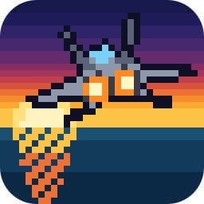
</p>

<h1 align="center">Top Gun: Fire at Will, native for Mac, Windows and Linux</h1>

<p align="center">
  The 1996 PlayStation dogfighting game, rebuilt as a real program for your computer.<br>
  Sharp graphics at any size, a proper launcher, controller support, and cheats.<br>
  <b>Free. Bring your own copy of the game.</b>
</p>

**Website:** [topgunfireatwill.tanookistudios.com](https://topgunfireatwill.tanookistudios.com)

## Download

| Your computer | Download | |
|---|---|---|
| **Mac** (Apple chip or Intel, macOS 11+) | [**TopGunFireAtWill-Mac.zip**](https://github.com/TanookiStudios/TopGunFireAtWillRecomp/releases/latest/download/TopGunFireAtWill-Mac.zip) | Signed and notarized by Apple |
| **Windows** (64-bit) | [**TopGunFireAtWill-Windows.zip**](https://github.com/TanookiStudios/TopGunFireAtWillRecomp/releases/latest/download/TopGunFireAtWill-Windows.zip) | |
| **Linux** (64-bit, most desktops from 2020 on) | [**TopGunFireAtWill-Linux.tar.gz**](https://github.com/TanookiStudios/TopGunFireAtWillRecomp/releases/latest/download/TopGunFireAtWill-Linux.tar.gz) | |

Every version and its notes are on the [Releases page](https://github.com/TanookiStudios/TopGunFireAtWillRecomp/releases).

## How to play

1. Download the version for your computer and unzip it.
   - **Mac:** drag **Top Gun Fire at Will** into Applications (or anywhere) and double-click it.
   - **Windows:** open the folder and double-click **TopGunFireAtWill.exe**.
   - **Linux:** open the folder and double-click **TopGunFireAtWill** (or run `./TopGunFireAtWill`).
2. The launcher asks for your game disc. Pick the **`.cue`** file of your own
   **Top Gun: Fire at Will (USA)** disc image (its `.bin` file must sit next to it).
   The launcher checks it and shows **Disc verified** when it's the right one.
3. Set any options you like (the **Game** button has the cheats and sound switches), then press **Play**.

No game files come with this download, and no PlayStation BIOS is needed: the free
[OpenBIOS](https://github.com/grumpycoders/pcsx-redux) is built in. The disc that works is:

| | |
|---|---|
| Game | Top Gun: Fire at Will (USA), SLUS-00032 |
| `.bin` SHA-256 | `c221dce3ef23863613a93611f29f4ddad10343c2a706b01720e56d95702e2cb1` |

### Controls

| PlayStation | Keyboard | What it does in the game |
|---|---|---|
| D-pad | Arrow keys | Fly: Up dives, Down climbs, Left / Right roll |
| ✕ | X | Fire the gun |
| ○ | S | Fire a missile |
| □ | Z | Drop a flare / chaff |
| △ | A | Pick the weapon |
| R1 | W | Next target |
| R2 | R | More throttle |
| L2 | E | Less throttle |
| L1 | Q | Change cockpit screen |
| Start | Enter | Pause |
| Select | Right Shift | Change the view |
| **Menu** | **Esc** | This port's menu |

The game's own **Options → Controller** screen offers two more button layouts.

**Controllers:** plug one in and play, no setup. Xbox, PlayStation (3, 4 and 5), Switch Pro and Joy-Con,
8BitDo, and over 2,000 other pads are recognized by name. The keyboard keeps working alongside a controller.
Everything can be remapped in **Settings**, and the **Esc** menu opens from a controller with the
Guide / Home button (or Select plus a click of the left stick).
Own mappings: put a `gamecontrollerdb.txt` in the settings folder
(Mac: `~/Library/Application Support/TopGunFireAtWill`, Windows and Linux: next to the program).

## What's in it

- **Native code.** The game's own program was translated into native code, so it runs as a real Mac, Windows or Linux app.
- **Sharp at any size.** Integer scaling grows the picture in whole steps so every line stays even; render the 3D at up to 4K in Settings.
- **Launcher.** Set everything before you play: display, sound, controls, cheats.
- **In-game menu (Esc).** Change settings, save and load states, reset the game, or close it.
- **Sound.** Volume, and separate switches to mute the music (and movies) or the sound effects.
- **The movies play.** The full-motion video cutscenes and briefings run as on the console.
- **Memory card saves.** The game's own saves work, kept in your settings folder.
- **Cheats.** Infinite missiles, infinite lives, start at any of the 32 missions, and skip to the next one.

## Screenshots

<p>
  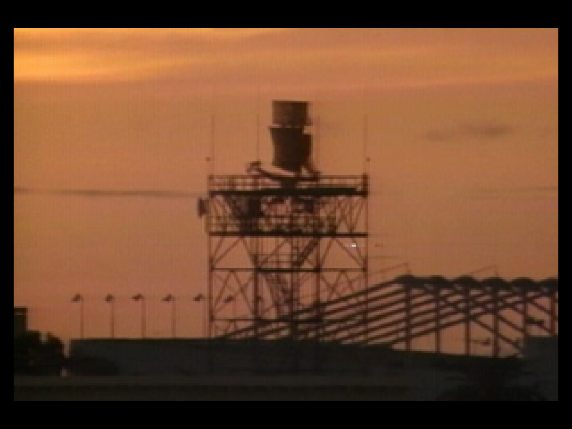
  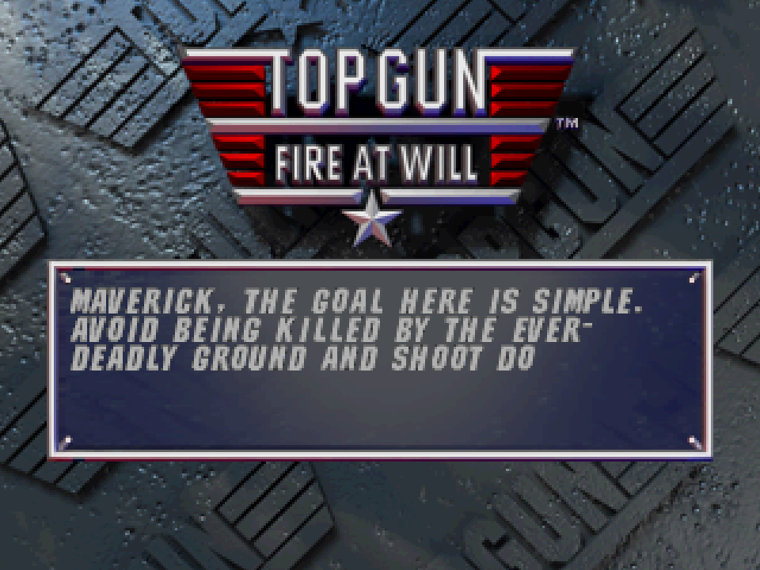
  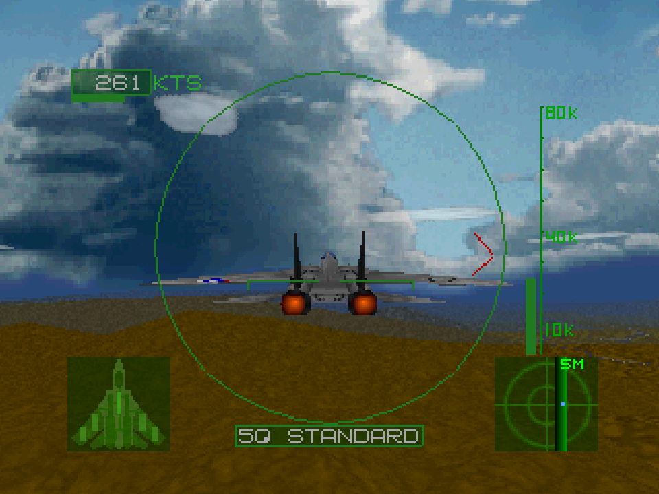
</p>
<p>
  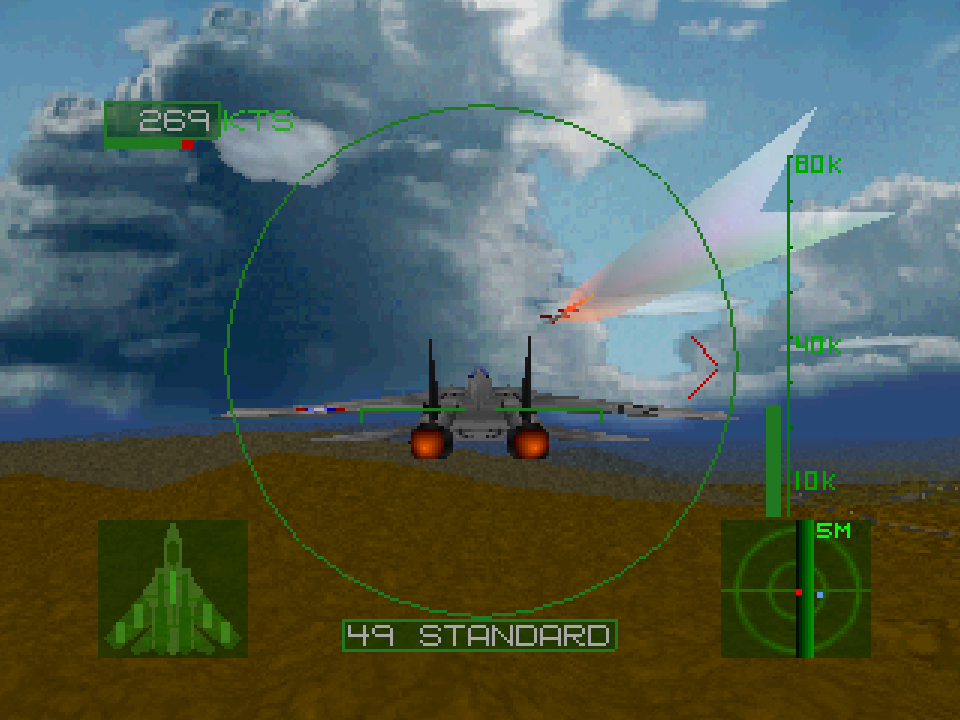
  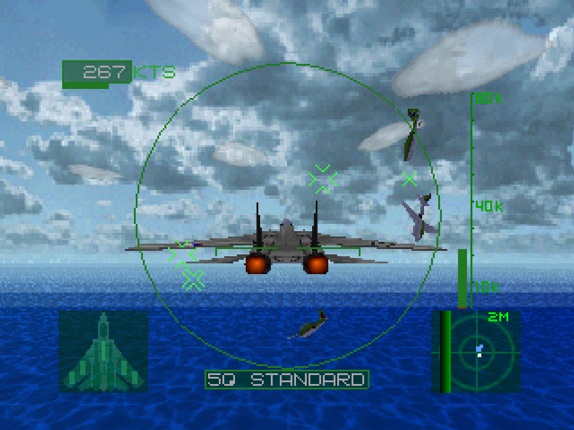
  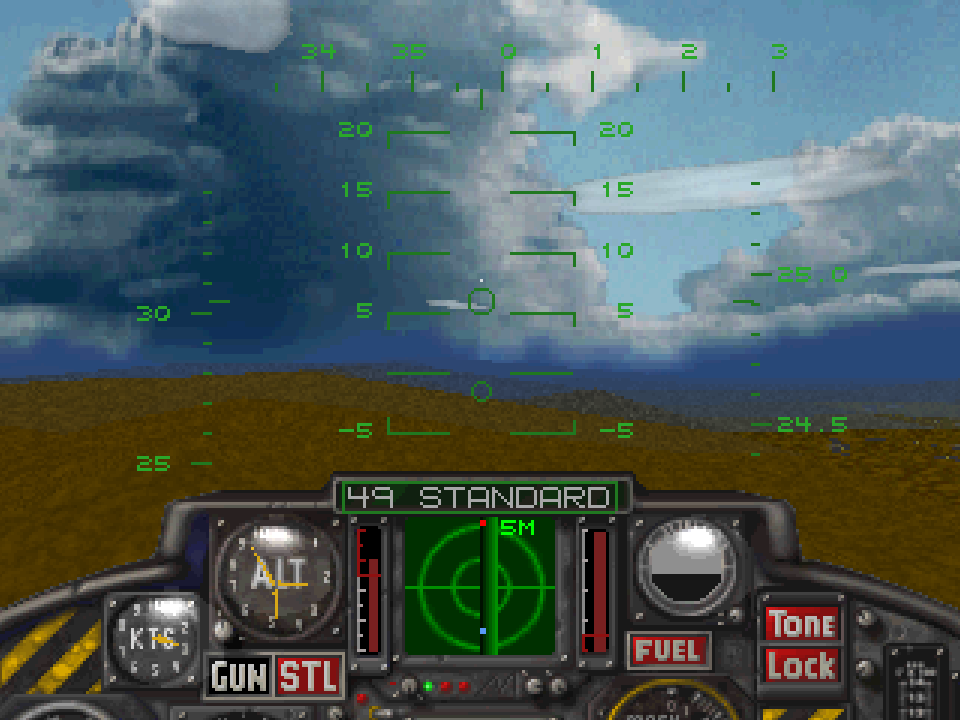
</p>
<p>
  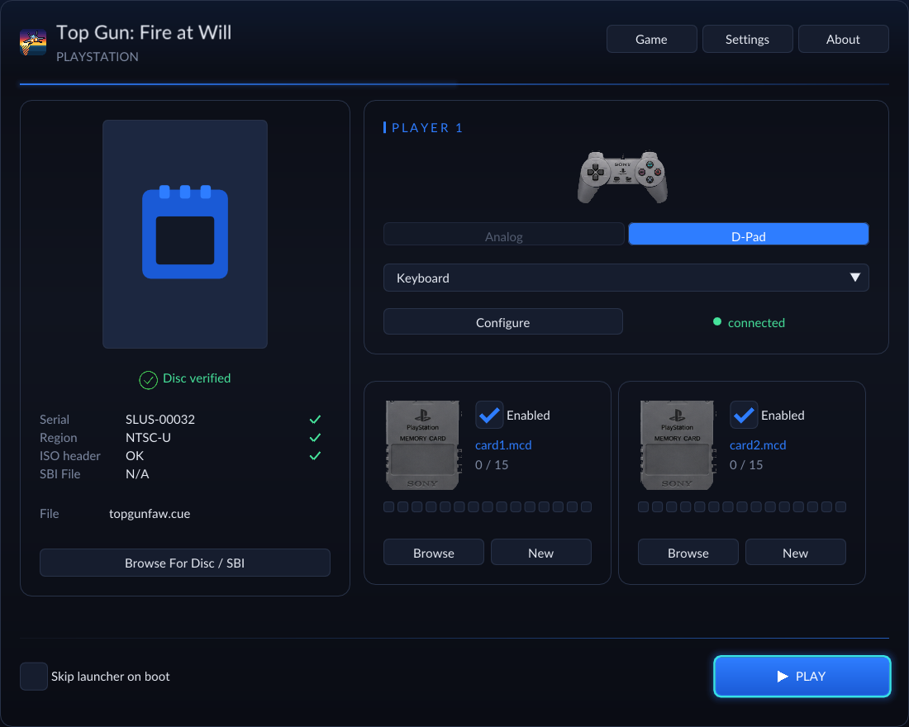
  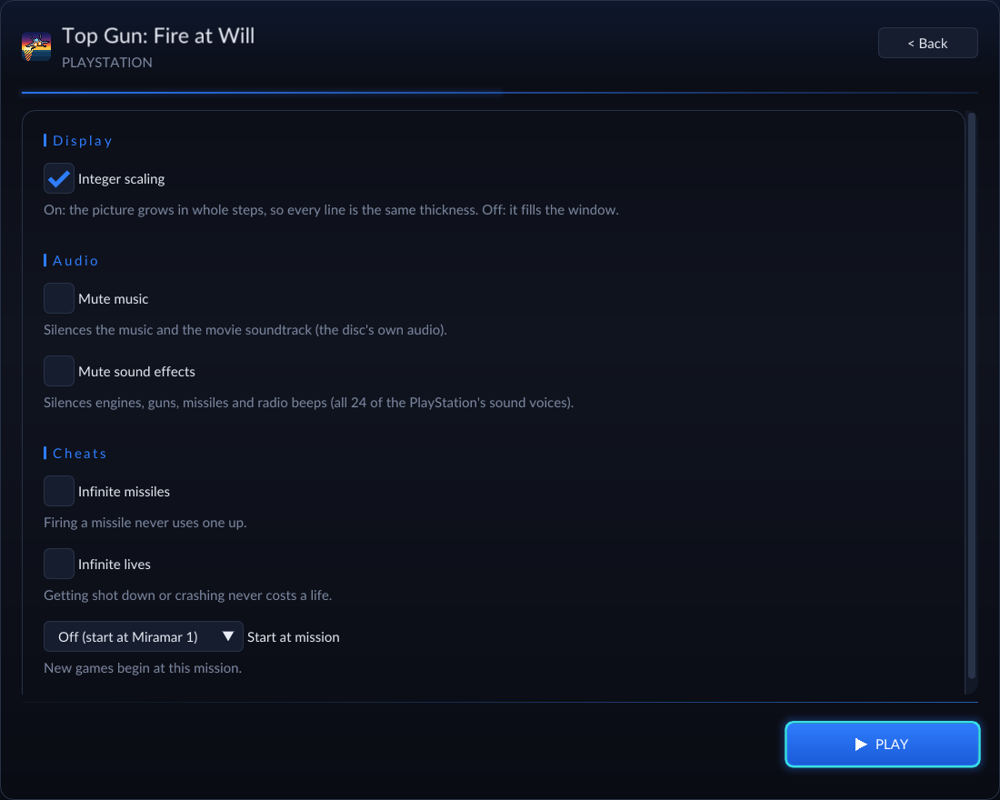
</p>
<p>
  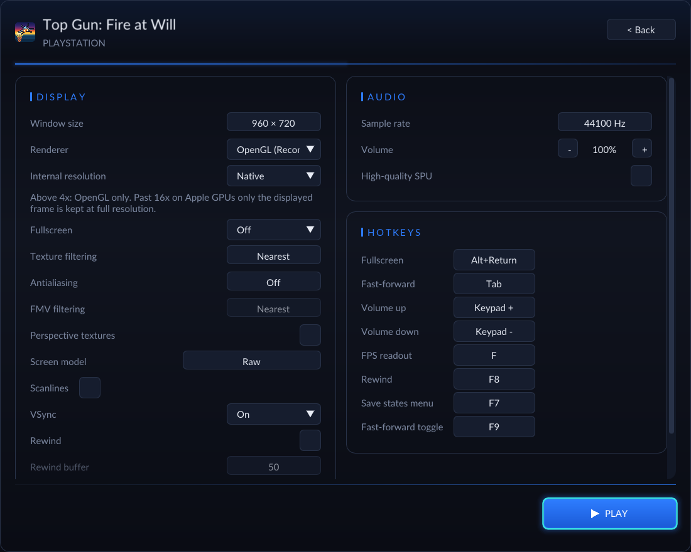
  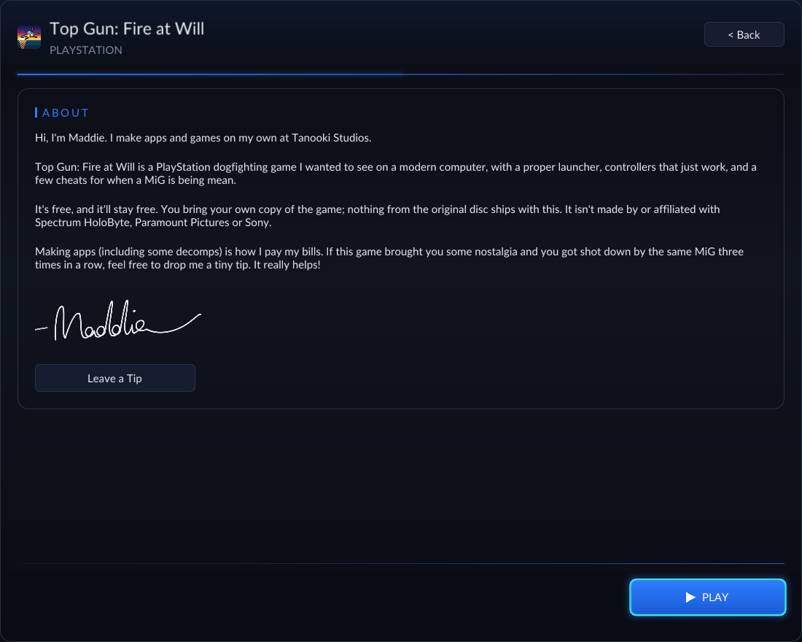
</p>
<p>
  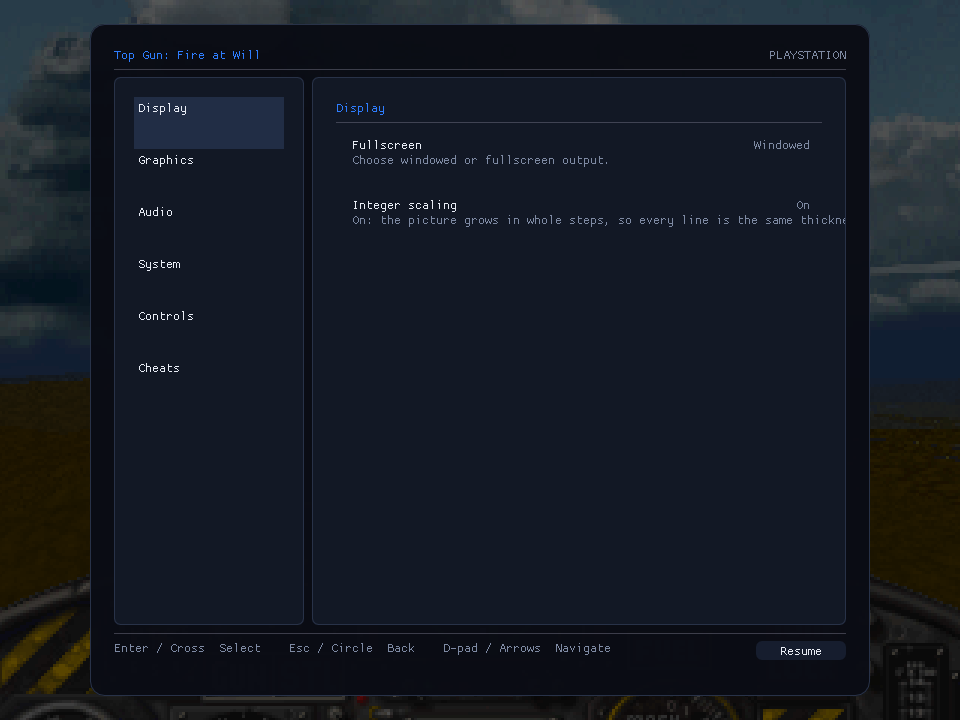
  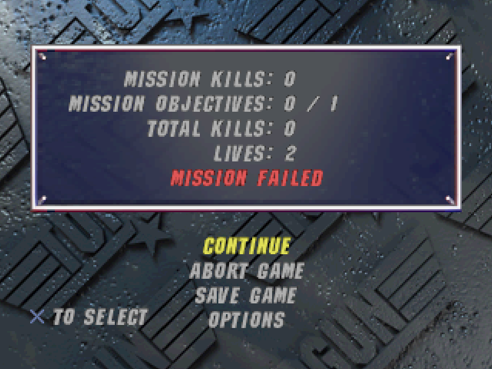
</p>

## Building it yourself

You need your own disc for this too: the build reads it to translate the game, and nothing from it is stored in this repository.

```sh
./setup.sh                                  # fetches the engine at the tested versions and applies patches/
cp "/path/to/Top Gun - Fire at Will! (USA).bin" disc/topgunfaw.bin
printf 'FILE "topgunfaw.bin" BINARY\n  TRACK 01 MODE2/2352\n    INDEX 01 00:00:00\n' > disc/topgunfaw.cue
echo disc/topgunfaw.cue > disc.cfg
bash tools/regen.sh                         # translates your disc's program into C (kept out of git)
cmake -S . -B build -G Ninja -DCMAKE_BUILD_TYPE=Release
cmake --build build
```

Release builds: `tools/make_app.sh --notarize` (Mac), `tools/make_windows_zip.sh` (Windows, cross-built on a Mac),
`tools/make_linux.sh` (Linux, built in an Ubuntu 20.04 container). Screenshots: `tools/capture-screenshots.sh`.
How the cheats were found and proven: [notes/ram-map.md](notes/ram-map.md).

## About Maddie

Hi, I'm Maddie. I make apps and games on my own at [Tanooki Studios](https://tanookistudios.com).

Top Gun: Fire at Will is a PlayStation dogfighting game I wanted to see on a modern computer, with a proper launcher,
controllers that just work, and a few cheats for when a MiG is being mean.

It's free, and it'll stay free. Making apps (including some decomps) is how I pay my bills. If this game brought you some nostalgia and you got shot down by the same MiG three times in a row, feel free to drop me a tiny tip. It really helps!


**[Leave a Tip](https://tanookistudios.com/SupportMe)**

## Credits and legal

- Built on [psxrecomp](https://github.com/mstan/psxrecomp) by Matthew Stanley (PolyForm Noncommercial 1.0.0)
  and [recomp-ui](https://github.com/RetroPortingToolKit/recomp-ui) (MIT), with [OpenBIOS](https://github.com/grumpycoders/pcsx-redux) (MIT),
  [SDL](https://libsdl.org) (zlib), [Dear ImGui](https://github.com/ocornut/imgui) (MIT), and the
  [SDL_GameControllerDB](https://github.com/mdqinc/SDL_GameControllerDB) controller list (zlib). Full texts: [THIRD_PARTY_NOTICES.md](THIRD_PARTY_NOTICES.md).
- This project's own code is under the [PolyForm Noncommercial License 1.0.0](LICENSE). It may never be sold.
- Top Gun is a trademark of Paramount Pictures. Fire at Will was made and published by Spectrum HoloByte.
  PlayStation is a trademark of Sony Interactive Entertainment. This project is not made by, endorsed by, or affiliated
  with any of them. It contains no game data: you supply your own.
